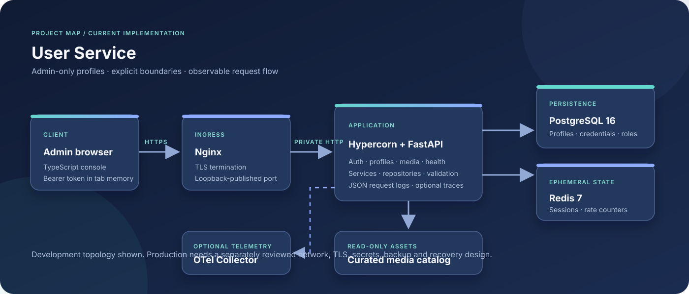

# User Service

**Admin-only profile management. Explicit security boundaries. A practical Python service architecture.**

[Documentation](docs/index.md) · [Architecture](docs/architecture.md) · [Technology decisions](docs/technology-stack.md) · [Roadmap](docs/roadmap.md)

> **Language / Язык:** [English](#english) · [Русский](#russian)

## English

User Service is a deliberately focused backend for managing user profiles through an administrator-only HTTP API. It combines FastAPI, PostgreSQL, Redis-backed administrator sessions, a small TypeScript web console, and a containerized local environment.

The project favours a narrow, inspectable security model over an oversized feature list: profile data is not an identity credential, creating a profile does not grant login access, and every profile operation requires an active administrator.

### At a glance

| Area | Current implementation |
| --- | --- |
| Product | Administrator-operated user-profile service |
| API | FastAPI, HTTPS, generated OpenAPI |
| Runtime | Python 3.14+, Hypercorn |
| Persistence | PostgreSQL 16, SQLAlchemy async, Alembic |
| Sessions and rate limits | Redis 7, opaque short-lived bearer sessions |
| Password storage | Argon2id via argon2-cffi |
| Web console | TypeScript 5.9.3, HTML and CSS |
| Local environment | Docker Compose, Nginx TLS ingress |
| Quality gates | pytest, Ruff, Import Linter, Bandit, pip-audit, CodeQL and workflow checks |
| Telemetry | JSON request logs; optional OpenTelemetry traces over OTLP |

### Why this project exists

Many small services begin with a profile table and gradually accumulate authentication, roles, media, operations and deployment logic without clearly defined boundaries. User Service keeps those concerns visible and deliberately limits what the current product promises.

- **Profiles are not accounts.** A profile can exist without credentials or a role.
- **Administration is explicit.** The built-in role is <code>admin</code>; profile endpoints are not public.
- **PostgreSQL is authoritative.** Account and role state live in the database; Redis stores expiring session state and rate counters.
- **The local environment is inspectable.** Nginx, the application, PostgreSQL and Redis run in separate Compose services and networks.
- **Roadmap is not reality.** Planned identity, tenant and media features are labelled as proposals, not shipped functionality.

### Current capabilities

| Capability | What is implemented |
| --- | --- |
| Administrator authentication | Local login, logout, identity lookup and password rotation |
| Administrator lifecycle | Protected role grant/revocation with reauthentication and last-admin safeguards |
| Profile CRUD | Create, list, read, update and delete, restricted to active administrators |
| Data integrity | UUID identifiers, normalized unique email, bounded deterministic pagination |
| Web console | Administrator sign-in and profile management on the same HTTPS origin |
| Curated media | Read-only operator-managed catalog; browser-local file selection never uploads |
| Health | Liveness and readiness endpoints |
| Engineering controls | Automated tests, architecture checks, dependency/security checks and contract validation |

### Scope boundaries

This is **not** currently a public identity platform or a production-as-a-service offering. The repository does not implement end-user registration or self-service, tenant isolation, MFA, SSO/OIDC, account recovery, user-media upload, a media-processing worker, or a production deployment runbook with approved SLOs. These subjects may appear in the roadmap, but a specification is not a deployed feature.

### Quick start

Requirements: Python 3.14+, [uv](https://docs.astral.sh/uv/), Docker with Compose, and Node.js/npm only when building the frontend outside Docker.

~~~sh
cp -n .env.example .env
# Replace POSTGRES_PASSWORD and REDIS_PASSWORD with unique local secrets.
make dev-certs
make up
~~~

Open [https://127.0.0.1:8000](https://127.0.0.1:8000). The local self-signed certificate is expected to trigger a browser warning. It is for development only and must not be reused in production.

Create the first administrator:

~~~sh
docker compose exec app python -m app.auth.cli bootstrap-admin
~~~

The CLI prompts for the email and password without echoing the password. Bootstrap is available only while no administrator role exists. Do not put credentials in shell history or command-line arguments.

### Development checks

~~~sh
uv sync --locked --all-groups
make frontend-install
make frontend-build
make check
make validate-specs
make architecture
~~~

<code>make check</code> runs lint/format checks, tests, architecture validation, contract validation, security tooling and frontend type checking. Docker-based checks require Docker; the performance suite is loopback-only and uses a disposable test database.

### Explore the project

| Start here | You will find |
| --- | --- |
| [Documentation index](docs/index.md) | Curated reading paths for developers, operators and reviewers |
| [Product overview](docs/product-overview.md) | Value proposition, audience, capabilities and limitations |
| [Architecture](docs/architecture.md) | Runtime topology, trust boundaries and module dependencies |
| [HTTP API](docs/api.md) | Authentication, profile and media endpoints, status codes |
| [Data model](docs/data-model.md) | PostgreSQL entities and relationships |
| [Security](docs/security.md) | Threat boundaries, authentication controls and operational caveats |
| [Technology decisions](docs/technology-stack.md) | Why each major technology is used, alternatives and trade-offs |
| [Glossary](docs/glossary.md) | Shared vocabulary and acronym definitions |
| [Observability](docs/observability.md) | Structured logs and optional tracing |
| [Performance](docs/performance.md) | Safe local load testing and interpretation |
| [Metrics](docs/metrics.md) | Repository facts, measurement definitions and baseline status |
| [Roadmap](docs/roadmap.md) | Proposed initiatives and decision gates |
| [Documentation standard](docs/documentation-standard.md) | Bilingual writing, translation and diagram conventions |

### Project snapshot

Static repository inventory captured on 2026-11-08. These figures describe checked-in files, not live usage or production performance.

| Indicator | Snapshot |
| --- | ---: |
| Tracked files | 140 |
| Automated test modules | 10 |
| Detailed roadmap specifications | 5 |
| Compose runtime services | 4 |
| Published production SLOs | Not established |
| Published benchmark baseline | Not established |

CI and CodeQL badges link to their live GitHub workflows. Stars, downloads, uptime, throughput and latency are intentionally not presented as marketing statistics without measurements.

### Ownership and license

The project founder, original creator, maintainer and rights holder for original project materials is **Almir Saitov** ([@GolangDeveloperAlmir](https://github.com/GolangDeveloperAlmir)). The repository uses the custom **Almir Open Attribution License (AOAL) 1.0**. Review [AUTHORS.md](AUTHORS.md) and [LICENSE](LICENSE) for attribution and reuse conditions. Third-party dependencies and externally sourced assets remain subject to their own licenses.

---

## Русский

User Service — намеренно узкоспециализированный backend для управления пользовательскими профилями через HTTP API, доступный только администраторам. В основе проекта FastAPI, PostgreSQL, сессии администратора в Redis, небольшая веб-панель на TypeScript и контейнерное локальное окружение.

Проект предпочитает ограниченную и понятную модель доступа длинному списку функций: профиль не является учётной записью, создание профиля не выдаёт права входа, а любая операция над профилями требует активную роль администратора.

### Кратко о проекте

| Область | Текущая реализация |
| --- | --- |
| Продукт | Сервис профилей под управлением администратора |
| API | FastAPI, HTTPS, генерируемый OpenAPI |
| Runtime | Python 3.14+, Hypercorn |
| Хранение | PostgreSQL 16, SQLAlchemy async, Alembic |
| Сессии и лимиты | Redis 7, короткоживущие opaque bearer-сессии |
| Хеширование паролей | Argon2id через argon2-cffi |
| Веб-панель | TypeScript 5.9.3, HTML и CSS |
| Локальная среда | Docker Compose, Nginx TLS ingress |
| Контроль качества | pytest, Ruff, Import Linter, Bandit, pip-audit, CodeQL и проверки workflow |
| Телеметрия | JSON-логи HTTP-запросов; опциональные OpenTelemetry traces через OTLP |

### Зачем существует проект

Небольшие сервисы часто начинают с таблицы профилей, а затем незаметно обрастают аутентификацией, ролями, медиа, эксплуатацией и логикой развёртывания. User Service делает эти границы явными и не обещает того, чего в коде ещё нет.

- **Профиль не равен аккаунту.** Запись профиля может существовать без credentials и роли.
- **Администрирование не подразумевается автоматически.** Встроенная роль одна — <code>admin</code>; публичного доступа к профилям нет.
- **PostgreSQL является источником истины.** Состояние аккаунтов и ролей хранится в БД, Redis содержит временные сессии и счётчики ограничений.
- **Локальное окружение прозрачно.** Nginx, приложение, PostgreSQL и Redis работают отдельными Compose-сервисами и сетями.
- **План развития не является текущей реализацией.** Будущие identity-, tenant- и media-функции помечаются как предложения.

### Что уже работает

| Возможность | Реализация |
| --- | --- |
| Аутентификация администратора | Локальный вход, выход, получение identity и смена пароля |
| Жизненный цикл администратора | Защищённое назначение/отзыв роли с повторной проверкой пароля и защитой последнего администратора |
| CRUD профилей | Создание, список, чтение, обновление и удаление только активным администраторам |
| Целостность данных | UUID, нормализация уникального email, ограниченная детерминированная пагинация |
| Веб-панель | Вход администратора и управление профилями с того же HTTPS origin |
| Каталог медиа | Read-only каталог оператора; локальный выбор файла в браузере не означает загрузку |
| Health | Liveness- и readiness-endpoints |
| Инженерные проверки | Автотесты, проверки архитектуры, зависимостей, безопасности и API-контрактов |

### Границы продукта

На данный момент это **не** публичная Identity-платформа и не готовый управляемый production-сервис. В репозитории нет пользовательской регистрации и self-service, изоляции арендаторов, MFA, SSO/OIDC, восстановления аккаунта, загрузки пользовательских медиа, worker обработки файлов или утверждённого production runbook с SLO. Эти темы могут находиться в roadmap, но спецификация ещё не делает функцию доступной.

### Быстрый запуск

Требуются Python 3.14+, [uv](https://docs.astral.sh/uv/), Docker с Compose и Node.js/npm только для самостоятельной сборки frontend вне Docker.

~~~sh
cp -n .env.example .env
# Замените POSTGRES_PASSWORD и REDIS_PASSWORD уникальными локальными секретами.
make dev-certs
make up
~~~

Откройте [https://127.0.0.1:8000](https://127.0.0.1:8000). Локальный self-signed сертификат вызовет предупреждение браузера. Он предназначен только для разработки и не должен использоваться в production.

Создайте первого администратора:

~~~sh
docker compose exec app python -m app.auth.cli bootstrap-admin
~~~

CLI запросит email и пароль интерактивно, не отображая пароль. Bootstrap доступен только пока в системе нет роли администратора. Не помещайте credentials в историю shell или аргументы командной строки.

### Проверки разработки

~~~sh
uv sync --locked --all-groups
make frontend-install
make frontend-build
make check
make validate-specs
make architecture
~~~

<code>make check</code> запускает lint/format, тесты, проверку архитектуры, API-контрактов, инструменты безопасности и проверку типов frontend. Для Docker-проверок нужен Docker; нагрузочный набор работает только через loopback и использует отдельную тестовую БД.

### Куда идти дальше

| Документ | Что внутри |
| --- | --- |
| [Индекс документации](docs/index.md) | Маршруты чтения для разработчика, оператора и ревьюера |
| [Обзор продукта](docs/product-overview.md) | Ценность, аудитория, возможности и границы |
| [Архитектура](docs/architecture.md) | Топология, границы доверия и зависимости модулей |
| [HTTP API](docs/api.md) | Аутентификация, профили, медиа и коды ответов |
| [Модель данных](docs/data-model.md) | Сущности PostgreSQL и связи |
| [Безопасность](docs/security.md) | Границы угроз, механизмы аутентификации и эксплуатационные оговорки |
| [Выбор технологий](docs/technology-stack.md) | Причины выбора, альтернативы, преимущества и риски |
| [Глоссарий](docs/glossary.md) | Единая терминология и расшифровка сокращений |
| [Наблюдаемость](docs/observability.md) | Структурированные логи и опциональная трассировка |
| [Производительность](docs/performance.md) | Безопасное локальное тестирование нагрузки |
| [Метрики](docs/metrics.md) | Факты репозитория, определения измерений и состояние baseline |
| [План развития](docs/roadmap.md) | Предложения и точки принятия решений |
| [Стандарт документации](docs/documentation-standard.md) | Двуязычный текст, перевод и правила диаграмм |

### Снимок проекта

Статическая инвентаризация репозитория на 2026-11-08. Эти числа описывают файлы в Git, а не активность пользователей или production-производительность.

| Показатель | Состояние |
| --- | ---: |
| Отслеживаемые файлы | 134 |
| Модули автоматических тестов | 10 |
| Подробные спецификации roadmap | 5 |
| Группы runtime-сервисов в Compose | 4 |
| Опубликованные production SLO | Не установлены |
| Опубликованный benchmark baseline | Не установлен |

Значки CI и CodeQL ведут на реальные GitHub workflows. Stars, загрузки, uptime, throughput и latency не используются как рекламные цифры без измерений.

### Авторство и лицензия

Основатель, первоначальный создатель, сопровождающий и правообладатель оригинальных материалов проекта — **Альмир Саитов** ([@GolangDeveloperAlmir](https://github.com/GolangDeveloperAlmir)). Репозиторий использует собственную лицензию **Almir Open Attribution License (AOAL) 1.0**. Условия атрибуции и повторного использования описаны в [AUTHORS.md](AUTHORS.md) и [LICENSE](LICENSE). Сторонние зависимости и внешние материалы сохраняют собственные лицензии.
