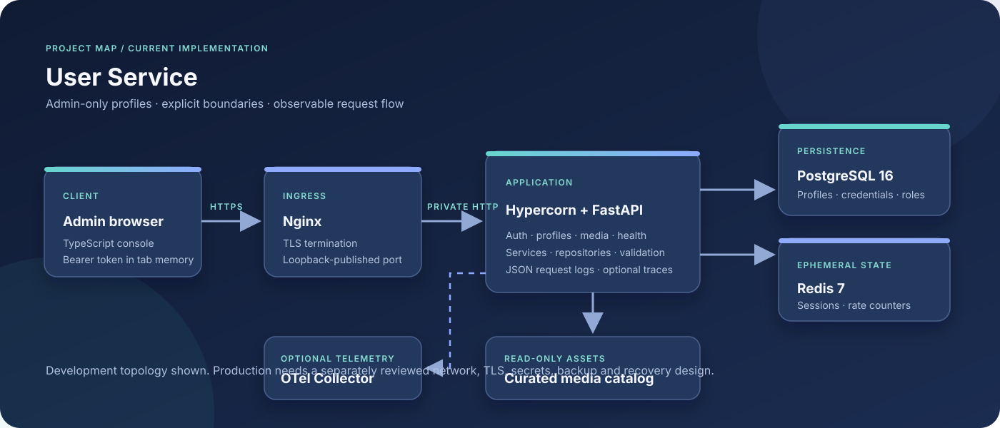

# Architecture and runtime design

> **Language / Язык:** [English](#english) · [Русский](#russian)
> **Status:** current checked-in runtime; proposed roadmap components are excluded.

## English

### Runtime topology

The local Compose environment separates ingress, application and data networks. Nginx terminates client TLS and forwards requests to Hypercorn/FastAPI over an isolated proxy network. PostgreSQL and Redis are reachable over a separate internal data network and are not published directly to the host.

~~~mermaid
flowchart LR
    Browser["Administrator browser"] -->|"HTTPS / TLS 1.2+"| Nginx["Nginx ingress"]
    Nginx -->|"HTTP on isolated proxy network"| App["Hypercorn + FastAPI"]
    App --> Users["Profile router / service / repository"]
    App --> Auth["Authentication and admin policy"]
    Users --> PostgreSQL[("PostgreSQL")]
    Auth --> PostgreSQL
    Auth --> Redis[("Redis sessions and rate limits")]
    App --> Media["Read-only curated media"]
    App -. "optional OTLP gRPC traces" .-> Collector["External collector"]
~~~

Compose is a **development environment**, not a production deployment recipe. Its self-signed certificate, local port binding and network assumptions must not be copied unchanged into production.

### Request lifecycle

1. The browser or API client establishes HTTPS to Nginx ingress.
2. Nginx forwards the request to the ASGI application over the private proxy network.
3. FastAPI applies trusted-host and request middleware checks. Forwarded client details are accepted only from configured proxy IPs.
4. Authentication dependencies resolve the bearer token and validate session state, user state and the <code>admin</code> role.
5. The route validates its request schema and calls a service.
6. The service applies business invariants using a request-scoped async SQLAlchemy session.
7. PostgreSQL remains authoritative for profile, credential and role data; Redis stores expiring session and rate-limit state.
8. The response passes through security-header and structured request-logging middleware.

### Module boundaries

| Module | Responsibility | Must not become |
| --- | --- | --- |
| <code>app.main</code> | Composition root, middleware, route registration and lifecycle | Domain/business-rule dumping ground |
| <code>app.auth</code> | Local credentials, sessions, administrator authorization and audit | Public registration or implied tenant policy |
| <code>app.users</code> | Profile HTTP contract, service rules and repository | Credential provisioning through profile creation |
| <code>app.db</code> | SQLAlchemy models, engine and session lifecycle | A second source of business authorization |
| <code>app.core</code> | Settings, logging and telemetry | A dependency on application/domain modules |
| <code>app.media</code> | Admin-only read-only catalog access | Upload processing or arbitrary filesystem access |
| <code>frontend</code> | Same-origin administrator interface | Independent authorization authority |

Dependencies point inward: <code>app.main</code> composes the system; <code>app.users</code> and <code>app.auth</code> use persistence; <code>app.db</code> uses shared core configuration; <code>app.core</code> must not depend on application or persistence modules. <code>tests/test_architecture.py</code> and <code>.importlinter</code> enforce configured dependency rules. Run <code>make architecture</code>.

### Profile operation path

~~~mermaid
sequenceDiagram
    participant C as Admin client
    participant R as FastAPI router
    participant S as UserService
    participant P as UserRepository
    participant DB as PostgreSQL
    C->>R: PATCH /users/{id} + Bearer token
    R->>R: Authenticate active admin
    R->>S: Validate profile update
    S->>P: Load profile / check normalized email
    P->>DB: SELECT
    DB-->>P: Profile row
    S->>P: Stage allowed field changes
    P->>DB: UPDATE / COMMIT
    DB-->>S: Persisted state
    S-->>R: Updated profile
    R-->>C: 200 response
~~~

The route does not directly own persistence rules. The service normalizes email, checks uniqueness and maps domain failures; the repository performs bounded queries and stages persistence operations. A database unique constraint remains the final guard against concurrent duplicate email writes.

### Trust boundaries and data ownership

- **Browser to Nginx:** TLS protects client-to-ingress transport.
- **Nginx to application:** HTTP is used only inside the isolated local Compose proxy network. Production network encryption must be selected from the real deployment trust model.
- **Application to PostgreSQL/Redis:** production configuration requires TLS for PostgreSQL and Redis; credentials are supplied through environment/secret management.
- **PostgreSQL:** source of truth for profiles, credentials, roles and audit records.
- **Redis:** ephemeral session state and rate-limit counters. Redis failure must not create an authorization fallback.
- **Media:** operator-managed regular files, exposed read-only through admin-only endpoints. No upload API or worker exists.

### Frontend boundary

The API and console share one HTTPS origin. <code>/</code> serves the console entry point and <code>/assets/*</code> serves compiled assets. The short-lived bearer token stays in tab memory and is not persisted to browser storage; reloading the page requires a new login. Selecting a local file uses browser-local object URLs and does not upload the file.

### Health, logs and traces

<code>/health/live</code> is a liveness check; <code>/health/ready</code> checks required dependencies. Request-completion events are JSON logs. OpenTelemetry tracing is optional and configured by <code>OTEL_EXPORTER_OTLP_ENDPOINT</code>. The repository does not currently configure a Prometheus metrics endpoint or dashboard stack. See [observability](observability.md) and [metrics](metrics.md).

### Related documents

[API contract](api.md) · [PostgreSQL model](data-model.md) · [Security architecture](security.md) · [Technology rationale](technology-stack.md) · [Future initiatives](roadmap.md)

---

## Русский

### Runtime-топология

Локальное Compose-окружение разделяет ingress, приложение и сеть данных. Nginx завершает TLS-соединение клиента и передаёт запросы Hypercorn/FastAPI через изолированную proxy-сеть. PostgreSQL и Redis доступны через отдельную внутреннюю data-сеть и не публикуются напрямую на host.

~~~mermaid
flowchart LR
    Browser["Браузер администратора"] -->|"HTTPS / TLS 1.2+"| Nginx["Nginx ingress"]
    Nginx -->|"HTTP в изолированной proxy-сети"| App["Hypercorn + FastAPI"]
    App --> Users["Router / service / repository профилей"]
    App --> Auth["Аутентификация и политика admin"]
    Users --> PostgreSQL[("PostgreSQL")]
    Auth --> PostgreSQL
    Auth --> Redis[("Redis: сессии и rate limits")]
    App --> Media["Read-only каталог медиа"]
    App -. "опциональные OTLP gRPC traces" .-> Collector["Внешний collector"]
~~~

Compose-стек является **окружением разработки**, а не рецептом production-развёртывания. Self-signed сертификат, локальную привязку порта и сетевые предположения нельзя без изменений переносить в production.

### Жизненный цикл запроса

1. Браузер или API-клиент устанавливает HTTPS-соединение с Nginx ingress.
2. Nginx передаёт запрос ASGI-приложению через приватную proxy-сеть.
3. FastAPI выполняет проверки trusted hosts и request middleware. Forwarded client details принимаются только от настроенных proxy IP.
4. Authentication dependencies проверяют bearer-токен, состояние сессии и пользователя, а также роль <code>admin</code>.
5. Route валидирует request schema и вызывает service.
6. Service применяет бизнес-инварианты с request-scoped async SQLAlchemy session.
7. PostgreSQL остаётся источником истины для профилей, credentials и ролей; Redis хранит временные сессии и rate-limit state.
8. Ответ проходит через middleware security headers и структурированного логирования запросов.

### Границы модулей

| Модуль | Ответственность | Чем не должен становиться |
| --- | --- | --- |
| <code>app.main</code> | Composition root, middleware, регистрация маршрутов и lifecycle | Свалкой доменной и бизнес-логики |
| <code>app.auth</code> | Локальные credentials, сессии, авторизация администратора и audit | Публичной регистрацией или неявной tenant-политикой |
| <code>app.users</code> | HTTP-контракт профилей, service-правила и repository | Способом создавать credentials при создании профиля |
| <code>app.db</code> | SQLAlchemy-модели, engine и lifecycle сессий | Вторым источником бизнес-авторизации |
| <code>app.core</code> | Settings, logging и telemetry | Зависимостью от application/domain-модулей |
| <code>app.media</code> | Admin-only доступ к read-only каталогу | Обработчиком загрузок или произвольной ФС |
| <code>frontend</code> | Same-origin интерфейс администратора | Независимым источником авторизации |

Зависимости направлены внутрь: <code>app.main</code> собирает систему; <code>app.users</code> и <code>app.auth</code> используют persistence; <code>app.db</code> использует общие настройки core; <code>app.core</code> не должен зависеть от application или persistence. <code>tests/test_architecture.py</code> и <code>.importlinter</code> проверяют заданные правила. Запуск: <code>make architecture</code>.

### Путь операции с профилем

~~~mermaid
sequenceDiagram
    participant C as Admin client
    participant R as FastAPI router
    participant S as UserService
    participant P as UserRepository
    participant DB as PostgreSQL
    C->>R: PATCH /users/{id} + Bearer token
    R->>R: Аутентификация активного admin
    R->>S: Проверка обновления профиля
    S->>P: Загрузка профиля / проверка email
    P->>DB: SELECT
    DB-->>P: Строка профиля
    S->>P: Подготовка разрешённых изменений
    P->>DB: UPDATE / COMMIT
    DB-->>S: Сохранённое состояние
    S-->>R: Обновлённый профиль
    R-->>C: Ответ 200
~~~

Route не должен владеть persistence-правилами напрямую. Service нормализует email, проверяет уникальность и преобразует domain errors; repository выполняет ограниченные запросы и подготавливает изменения. Уникальный constraint БД остаётся последней защитой от конкурентной записи одинакового email.

### Границы доверия и владение данными

- **Браузер → Nginx:** TLS защищает транспорт от клиента до ingress.
- **Nginx → приложение:** HTTP используется только внутри изолированной локальной Compose proxy-сети. Для production шифрование выбирается исходя из реальной модели доверия.
- **Приложение → PostgreSQL/Redis:** production-конфигурация требует TLS для PostgreSQL и Redis; credentials передаются через environment/secret management.
- **PostgreSQL:** источник истины для профилей, credentials, ролей и audit-записей.
- **Redis:** временное состояние сессий и rate-limit counters. Отказ Redis не должен открывать обход авторизации.
- **Медиа:** обычные файлы оператора, выдаваемые в read-only режиме через admin-only endpoints. API загрузки и worker отсутствуют.

### Граница frontend

API и панель используют один HTTPS origin. <code>/</code> отдаёт точку входа панели, <code>/assets/*</code> — собранные assets. Короткоживущий bearer-токен остаётся в памяти вкладки и не сохраняется в browser storage; после перезагрузки страницы нужен новый вход. Выбор локального файла использует browser-local object URLs и не отправляет файл на сервер.

### Health, логи и traces

<code>/health/live</code> проверяет liveness; <code>/health/ready</code> проверяет обязательные зависимости. Завершение HTTP-запроса записывается в JSON log. OpenTelemetry tracing является опциональной и включается через <code>OTEL_EXPORTER_OTLP_ENDPOINT</code>. Сейчас репозиторий не настраивает Prometheus metrics endpoint или набор dashboards. См. [наблюдаемость](observability.md) и [метрики](metrics.md).

### Связанные документы

[API-контракт](api.md) · [Модель PostgreSQL](data-model.md) · [Архитектура безопасности](security.md) · [Причины выбора технологий](technology-stack.md) · [Будущие инициативы](roadmap.md)
