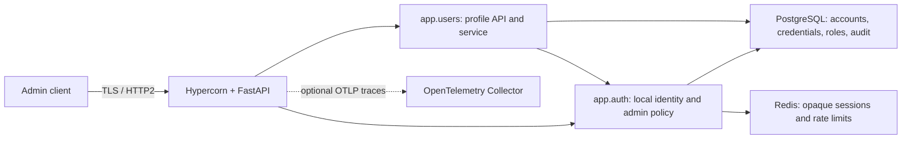

# Architecture

## Runtime shape

`app.main` is the composition root. `app.users` exposes profile operations;
`app.auth` provides local credential/session services and deny-by-default
authorization; `app.db` owns persistence models and connections; `app.core`
owns settings, logging, and telemetry. The profile model lives in
`app.db.user_model` so auth and profile code share one persistence entity
without importing one another's domain package.

All profile routes require an active local administrator. The role and account
state are checked against PostgreSQL on authenticated requests. Redis stores
only short-lived session state and rate counters; Redis failure never grants
access. Passwords are Argon2id hashes, and opaque bearer tokens are not stored
in plaintext.

Profile CRUD is split into an HTTP router, a business-rule service, and a
repository. The repository applies bounded, deterministic pagination; the
service canonicalizes email, maps missing profiles to domain errors, and
translates database uniqueness races into a conflict. Profile creation does
not provision local credentials or a role. The router owns HTTP response
models and coordinates admin-session revocation for protected account changes.
Each request uses one async database session; mutations commit in the service,
while administrator invariants use a PostgreSQL advisory transaction lock.

Модель профиля расположена в `app.db.user_model`, чтобы auth и profile
использовали одну сущность, не импортируя пакеты друг друга.

## Trust boundaries and transport

Hypercorn terminates TLS and negotiates HTTP/2 using ALPN. Plain HTTP receives
`426 Upgrade Required`. Compose publishes the application only on the host's
loopback interface; PostgreSQL and Redis are not publicly published. The
development certificate is self-signed and must never be reused in production.

Production configuration is validated at startup: explicit allowed hosts,
TLS-enabled PostgreSQL, TLS-enabled Redis with a password, and
`APP_ENV=production`. There is no implicit trust of forwarded client-IP
headers. Proxy deployments need an explicit, reviewed proxy trust design.

Hypercorn завершает TLS и согласует HTTP/2 через ALPN. Обычный HTTP получает
`426`. Compose публикует приложение только на loopback интерфейсе; PostgreSQL
и Redis не публикуются наружу. Self-signed сертификат предназначен только
для разработки.

## Module boundaries

Dependencies point inward:

1. `app.main` is the composition root.
2. `app.users` can depend on `app.auth` and persistence.
3. `app.auth` can depend on `app.db`.
4. `app.db` can depend on `app.core` settings.
5. `app.core` must not depend on application or persistence modules.

`tests/test_architecture.py` and `.importlinter` enforce these boundaries. Run
both using `make architecture`.

## Data and API contracts

PostgreSQL migrations define user profiles, local credentials, roles, and
security audit events. Redis session state is ephemeral. See
[data-model.md](data-model.md) for the ER diagram and retention caveats.

FastAPI/Pydantic is the source of truth for OpenAPI. Generate the committed
snapshot with `make openapi`; `make validate-specs` checks it against runtime
routes and validates AsyncAPI's intentionally empty HTTP-only state using the
bundled official schema.

Python module, class, and public function docstrings describe runtime
boundaries and important service invariants. See [api.md](api.md) for the
profile request contract and [data-model.md](data-model.md) for persisted
entities.

## Operations and CI

`docker-compose.yml` runs the API, PostgreSQL, and password-protected Redis.
The API uses a non-root multi-stage image and requires mounted TLS material.
`docker-compose.override.yml` adds source reload and a loopback-only database
port for local development. The Dev Container uses the same project toolchain.

CI runs tests, architectural checks, dependency and secret scans, SAST,
workflow linting, CodeQL, a Trivy image gate, and a loopback-only authenticated
performance smoke test. See [security.md](security.md) and
[performance.md](performance.md).

## Архитектура

Сервис запускается через Hypercorn/FastAPI. `app.main` связывает компоненты,
`app.users` предоставляет profile API, `app.auth` — локальные credentials,
sessions и deny-by-default policy, `app.db` — модели/соединения, `app.core` —
общие настройки, логи и telemetry. Все операции профиля требуют активную
роль `admin`; состояние роли проверяется по PostgreSQL, сессии и rate-limit
хранятся в Redis.

Приложение доступно только по TLS; для HTTP возвращается `426`. Для production
обязательны явные hosts, TLS PostgreSQL/Redis и пароль Redis. Подробные
диаграммы, security controls и CI gates описаны в
[security.md](security.md) и [data-model.md](data-model.md).

OpenAPI генерируется из FastAPI; обновите snapshot командой `make openapi`.
AsyncAPI фиксирует отсутствие event channels. Направление импортов проверяют
pytest и Import Linter.

Profile CRUD разделён на HTTP-router, сервис бизнес-правил и repository.
Repository выполняет ограниченную стабильную пагинацию; сервис нормализует
email, обрабатывает отсутствующие профили и конфликты уникальности. Создание
профиля не создаёт local credential и не назначает роль. Router преобразует
ответы в API-схемы и координирует отзыв admin-сессий; изменения инвариантов
администраторов сериализуются PostgreSQL advisory lock. Публичные Python
модули, классы и функции описаны docstrings.
