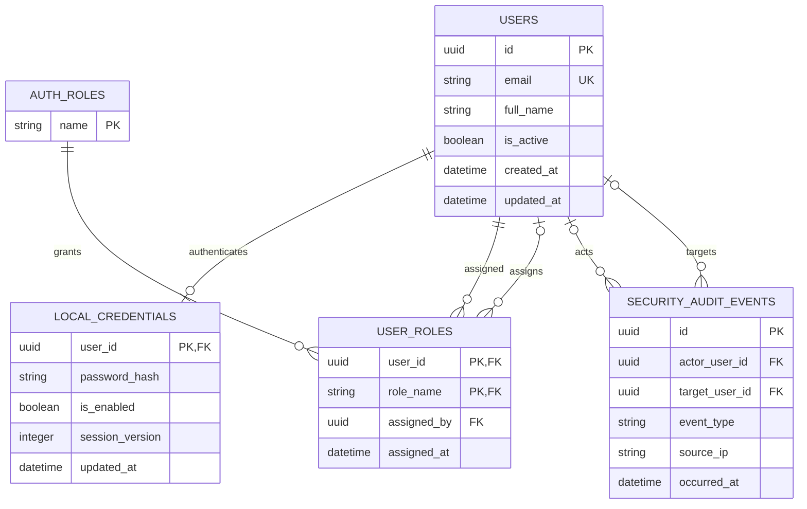
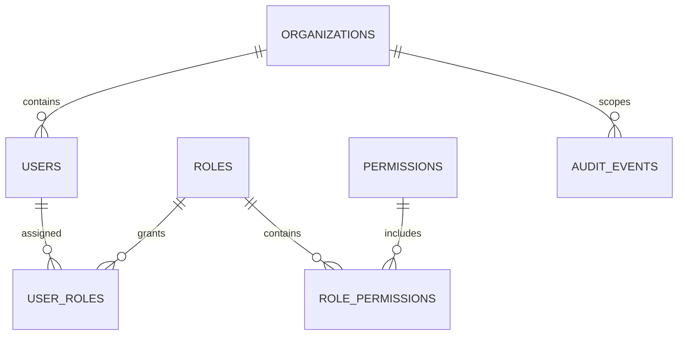

# Data model / Модель данных

## Implemented PostgreSQL schema / Реализованная схема PostgreSQL

The source of truth is the [SQLAlchemy model](../app/db/user_model.py),
[auth models](../app/auth/models.py), and migrations
[`0001`](../migrations/versions/0001_create_users.py) and
[`0002`](../migrations/versions/0002_local_auth_rbac.py). PostgreSQL stores
password hashes and role state; raw bearer tokens and session payloads are not
stored there. `app.users.model` remains a compatibility re-export of the
shared profile model.

PostgreSQL is the source for active account/role state. Redis stores
short-lived sessions and login rate counters; each session value contains the
user UUID and credential version, and its key derives from the token hash.
Authorization still reads account, credential, and role state from PostgreSQL,
so deactivation or role changes take effect on the next authenticated request.

## Notes / Примечания

- `local_credentials.user_id` and `users.id` have a one-to-one relationship.
- `user_roles` uses a composite primary key and currently contains only the
  built-in `admin` role.
- A profile is not an authentication account by itself: local login requires a
  separate `local_credentials` row and an active `admin` role assignment.
- Profile CRUD stores normalized email casing and uses the unique constraint
  on `users.email` as the final defense against concurrent writes.
- `assigned_by`, audit actor, and audit target references are nullable and use
  `ON DELETE SET NULL`; deleting a user does not erase the audit record.
- Audit events include security mutations and successful authentication
  lifecycle events. Failed logins are represented by rate counters, not audit
  rows.
- Audit retention is not automated; operators must define and implement a
  privacy-compliant retention policy.
- Redis session state is ephemeral. Losing Redis invalidates sessions and
  resets counters; PostgreSQL remains the source of role/credential state.
- Profile listing uses `created_at DESC, id ASC` with bounded `offset/limit`;
  this is a query behavior, not an additional database entity.

`local_credentials.user_id` связан с `users.id` отношением один-к-одному.
`user_roles` использует составной первичный ключ; сейчас существует только
встроенная роль `admin`. Ссылки `assigned_by`, actor и target допускают `NULL`
и используют `ON DELETE SET NULL`, поэтому удаление пользователя не стирает
audit-запись. Retention аудита автоматически не реализован.

Профиль сам по себе не является учётной записью для входа: локальная
аутентификация требует отдельную строку `local_credentials` и активную роль
`admin`. CRUD сохраняет email в нормализованном регистре; уникальное
ограничение `users.email` остаётся последней защитой от конкурентной записи.
Список читается по `created_at DESC, id ASC` с ограничениями `offset/limit`;
это поведение запроса, а не отдельная сущность данных.

## Future tenant model / Возможное развитие tenant-модели

Organizations, external identity-provider IDs, granular permissions, and
tenant-scoped records are not implemented. The diagram below is a design
sketch only; it is not the current database schema.

Organizations, внешние identity-provider IDs, granular permissions и
tenant-scoped записи пока не реализованы. Следующая диаграмма — только
концепция, а не схема текущей БД.

Any tenant model requires explicit tenant-scoped database constraints,
authorization checks on every operation, isolation tests, and a reviewed
migration plan. A role row alone is not a tenant boundary.

Tenant-модель требует явных tenant-scoped ограничений БД, проверки авторизации
в каждой операции, тестов изоляции и проверенного плана миграции. Одна строка
роли не является границей tenant-безопасности.
