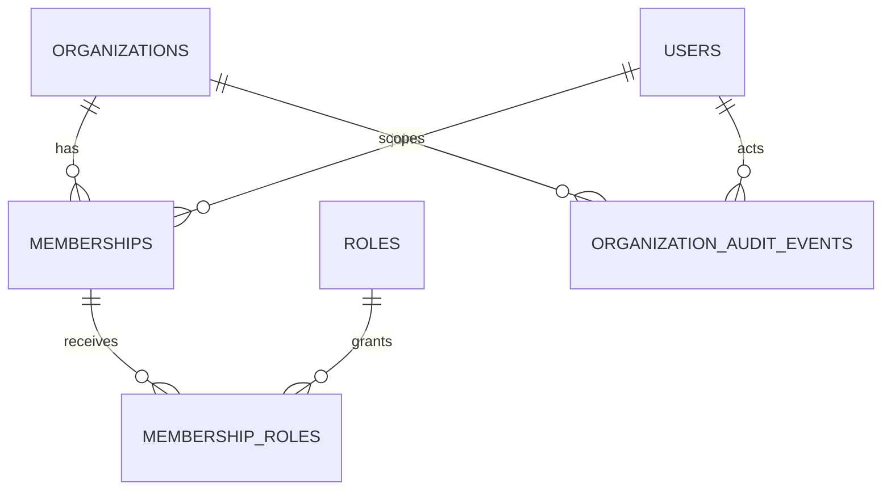

# 02. Организации, tenant isolation и RBAC

> **Статус:** условное будущее ТЗ (`PLAN-02`). Выполнять только после
> подтверждения multi-organization сценария и решений `ADR-001`–`ADR-003`.
> Сегодняшний API не предоставляет tenant isolation.

## 1. Цель и безопасность

Обеспечить, чтобы пользователь, приглашённый в одну организацию, не мог
прочитать, изменить, перечислить, удалить или косвенно обнаружить данные
другой организации. Роль отвечает за **действие**, а tenant-контекст —
за **область ресурсов**; оба условия должны проверяться на каждом пути.

Рекомендуемая исходная модель для оценки: глобальная запись identity/profile,
организации как отдельная сущность, членство `user ↔ organization` и
назначения ролей внутри членства. Это предложение, не принятое продуктовое
решение. Если email/профиль должны быть tenant-specific или пользователь не
может быть членом нескольких организаций, модель надо пересмотреть до
миграции.

## 2. Цели и не-цели

### Цели

- Явная Organization/Tenant с устойчивым UUID и состоянием.
- Membership со статусом, временем приглашения/активации и, если нужно,
  пригласившим субъектом.
- Минимально необходимый RBAC с ограниченными organization scope.
- Проверка scope в каждом repository query и mutation, включая count,
  pagination, uniqueness, nested resource, export и background job.
- Отдельная, явно аудируемая системная административная область.
- Безопасный перевод legacy пользователей/профилей без неявного объединения
  или помещения в «общую» организацию.

### Не-цели без отдельного ADR

- Атрибутная политика ABAC, произвольный policy language или пользовательские
  роли/permissions.
- Cross-organization поиск, глобальный directory и супер-админский
  impersonation.
- Создание организации для любого анонимного посетителя.
- Перевод профиля в аккаунт или автоматическое назначение credentials.
- Гарантия криптографической/физической изоляции между tenants. Планируемая
  граница — прикладная и реляционная; требования сильнее этого требуют
  отдельной архитектуры.

## 3. Предлагаемая доменная модель

Предварительная схема для проверки в ADR:

Кандидатные сущности и ограничения:

| Сущность | Кандидатные поля/ограничения | Что требуется решить |
| --- | --- | --- |
| `organizations` | `id`, `name`, `status`, `created_at`, `updated_at`; уникальность slug только если нужен внешний slug | Удаление, блокировка, перенос владения, lifecycle |
| `memberships` | `organization_id`, `user_id`, `status`, `joined_at`, `invited_by`; уникальность пары `(organization_id, user_id)` | Повторное приглашение, отмена, истечение, rejoin |
| `roles` | Стабильный идентификатор и ограниченный каталог ролей | Набор ролей, system vs tenant scope, изменение каталога |
| `membership_roles` | Ссылка на membership и role; составной уникальный ключ | Разрешены ли несколько ролей и кто назначает |
| organization-owned records | Tenant FK/ownership relation и tenant-scoped индексы/unique constraints | Какие текущие сущности и поля принадлежат организации |
| audit | Actor, действие, target, organization scope, timestamp, минимальный контекст | Согласовать с `PLAN-01` privacy/retention policy |

Схема должна запретить membership к несуществующей организации и
дублирующиеся назначения. Ограничения БД — дополнительная защита, но не
замена авторизации. Soft delete/архивация выбираются по требованиям аудита и
удаления; не вводить оба подхода без определения конечной семантики.

### Профиль и уникальность

Сейчас таблица профилей использует глобально уникальный нормализованный
email. До реализации определить:

1. Один человек — один глобальный профиль или отдельный профиль в каждой
   организации?
2. Может ли один email/identity входить в несколько организаций?
3. Должна ли уникальность быть глобальной, tenant-scoped или отличаться для
   login identifier и контактного адреса?
4. Кто владеет изменением email и как подтверждается право на него?

Не ослаблять constraint и не менять нормализацию до решения и отчёта о
коллизиях существующих данных.

## 4. Контракт доступа и API

Конкретные пути — предмет версионирования и клиентского решения. В качестве
кандидата рассмотреть явные ресурсы `/organizations` и
`/organizations/{organization_id}/members`; не считать этот пример
утверждённым контрактом. Запрос не должен определять полномочия простым
передачей произвольного `organization_id`. Сервер проверяет membership и
разрешение субъекта для запрошенной организации.

### Правила tenant-контекста

- Tenant scope извлекается из валидированного principal/membership либо
  ограничивается allowlisted route resource и затем проверяется авторизацией.
- ID в URL, query, header или body — только выбор ресурса для проверки, не
  доказательство права.
- Репозитории принимают явный tenant scope обязательным типизированным
  параметром; отсутствие scope не возвращает глобальный результат.
- `list`, `count`, pagination, filtering, sorting и export используют один и
  тот же tenant predicate.
- Update/delete сначала выполняются с tenant-scoped lookup; нельзя получить
  объект глобально, а после этого проверять права отдельным неатомарным шагом.
- Ошибка «ресурс в другом tenant» не должна давать доступ к его содержимому;
  единообразно выбрать `404` или `403` для anti-enumeration и закрепить это в
  API, логах и тестах.
- Background tasks, CLI, миграции и системные jobs должны явно иметь
  ограниченный system context; не переиспользовать HTTP principal неявно.

### Кандидатная матрица разрешений

| Действие | `member` | `organization_admin` | `system_operator` |
| --- | --- | --- | --- |
| Читать разрешённые записи своей организации | Да, по продуктовой политике | Да | Только через отдельный audited flow |
| Менять собственный профиль | Только разрешённые поля, после подтверждения | Да, по политике | Не по умолчанию |
| Пригласить/отозвать членство | Нет | Да, с ограничениями | Только отдельный административный процесс |
| Назначить роль | Нет | Только подмножество ролей и reauth/step-up, если принято | По специальному разрешению и audit |
| Читать/изменять данные другой организации | Нет | Нет | Запрещено по умолчанию; break-glass — отдельный ADR |
| Управлять глобальной платформой | Нет | Нет | Только system-scoped разрешения |

Матрица — черновик. До реализации каждая строка должна быть подтверждена
владельцем продукта; нужны ограничения на self-removal, последнего владельца,
выдачу максимальных ролей и удаление организации.

## 5. План перехода данных

Миграция не должна назначать всем текущим профилям несуществующую
«default organization» без подтверждённого владельца данных.

### Предлагаемые expand/backfill/validate/contract стадии

1. **Inventory:** снять количество профилей/администраторов, найти
   дубликаты/неоднозначные записи и определить владельца каждого набора.
   Снимки содержат только защищённые данные; отчёты не коммитить.
2. **Expand:** добавить новые таблицы и nullable/совместимые ссылки; старый
   API и schema сохраняют прежнее поведение.
3. **Backfill:** создать организации и memberships только по утверждённой
   карте владения. Записывать обработанные/отклонённые записи, контрольные
   количества и повторяемость job.
4. **Validate:** проверить FK, membership uniqueness, распределение профилей,
   права и выборки; провести сверку и утвердить исключения с владельцем данных.
5. **Dual-read/guard:** при необходимости сначала сравнить старые и новые
   результаты в непроизводственном окружении; production shadow mode не
   должен раскрывать данные и не должен менять результат клиенту.
6. **Enforce:** включить обязательный tenant scope поэтапно после полного
   backfill и прохождения tenant isolation suite.
7. **Contract:** удалить старые пути/поля только после периода поддержки,
   миграции клиентов и отдельного release decision.

Каждому этапу нужны оценка блокировок и времени на копии production-size
данных, повторный запуск после частичного сбоя, backup до destructive steps,
stop condition и проверенный способ восстановления.

## 6. Тестовая и security матрица

Обязательные тесты до включения любого tenant API:

- `member A` не может получить профиль `member B` другого tenant через
  direct read, update, delete, list, pagination, filters, count, malformed ID
  или повтор запроса.
- Невалидный, отсутствующий, отозванный и suspended membership отказывает
  при каждой операции.
- Тестируются ошибочно переданный tenant ID, повторные/параллельные запросы,
  race на изменение membership/role и отзыв сессии.
- Каждая новая таблица и внешняя ссылка проверяется на уникальность,
  referential integrity, cascade/RESTRICT поведение и orphan prevention.
- Сортировки, фильтры, search, экспорт и агрегаты не обходят tenant
  predicate; ошибка одного tenant не возвращает partial global data.
- Admin routes, CLI, background jobs и health/debug инструменты имеют явно
  проверенный scope.
- Тестируются migration с нулём, ожидаемым объёмом, дубликатами,
  отсутствующим owner mapping и частично завершённым backfill.
- OpenAPI security схемы и ошибки соответствуют фактическому
  authorization behavior; отказ не содержит чужого payload.
- Набор архитектурных тестов проверяет зависимость auth/domain/repository и
  не позволяет общему helper скрыто обходить scope.

Нужно добавить позитивные тесты каждой разрешённой роли, negative-тесты
каждой границы и отдельный регрессионный набор, который повторяется после
любого изменения repository/query policy. Одного unit-теста на dependency
недостаточно: нужны интеграционные проверки SQL и API.

## 7. Rollout и rollback

Перед пилотом: утвердить матрицу ролей, migration report, backup/restore
evidence, tenant isolation suite, метрики отказов, клиентский контракт,
support runbook и владельца переключения. Начать на изолированной тестовой
организации/данных, затем включать ограниченному набору потребителей.

Откатывать можно только код и новые не обязательные расширения схемы. Если
данные уже записаны в tenant-формате, rollback не должен удалять membership
или объединять tenants. Заранее определить forward-fix и restore procedure.
После переключения обязательного tenant scope запрещено открывать legacy
глобальные endpoints, если они способны обойти новую модель.

## 8. Критерии приёмки

- ADR утверждает глобальность identity/profile, membership, email uniqueness,
  lifecycle и system-admin boundary.
- Все tenant-owned сущности имеют явное и валидируемое владение.
- Ни один API/list/count/export/background path не выполняет tenant-owned
  чтение/изменение без scope и проверки разрешения.
- Все межтенантные negative-тесты проходят на DB и HTTP уровнях, включая
  ошибочные и конкурентные сценарии.
- Backfill идемпотентен, сверяем и испытан на репрезентативной копии;
  неоднозначные записи не назначаются автоматически.
- Стратегия совместимости, миграции клиентов и удаления legacy API
  опубликована до rollout.
- Audit фиксирует привилегированные назначения и изменения в объёме,
  утверждённом privacy policy.
- Документация API, architecture, data model, security и эксплуатационные
  инструкции обновлена вместе с контрактом.

## English summary

`PLAN-02` is conditional on confirmed multi-organization product needs. It
proposes explicit organizations, memberships, scoped roles, mandatory tenant
filters in every query and mutation, and a staged migration that never assigns
legacy data to an unapproved default tenant. API paths, profile/email
uniqueness, role matrix, and system-operator access all require decisions
before implementation. Cross-tenant negative tests are release blockers.
