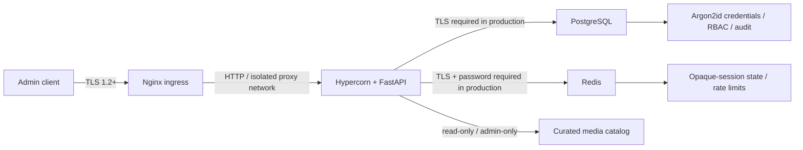

# Security architecture and operations

> **Language / Язык:** [English](#english) · [Русский](#russian)

<a id="english"></a>

## Status and scope

This document describes the controls implemented in this repository and the
operational assumptions they require. It is not a certification or a claim that
the service is a complete identity platform. Local credentials authenticate
administrator accounts only; every `/users` route is admin-only. There is no
customer self-service, MFA, SSO/OIDC integration, tenant isolation, or account
recovery workflow.

The security posture is deny-by-default: if a credential, role, session, Redis
state, host configuration, or required service is missing or invalid, access is
not granted. Production still requires an operator-managed deployment with
valid certificates, TLS-enabled PostgreSQL and Redis, restricted network
access, backups, and monitored security alerts.

## Assets and trust boundaries

| Asset | Storage | Protection |
| --- | --- | --- |
| Passwords | PostgreSQL `local_credentials` | Argon2id hashes; never returned or logged |
| Bearer session tokens | Client only | 256-bit opaque random tokens; HTTPS required |
| Session state | Redis | SHA-256 token-derived key, user ID and credential version; TTL |
| Profiles and role assignments | PostgreSQL | All profile endpoints require an active local admin |
| Security audit events | PostgreSQL | Append-only by application convention; operator-managed retention |
| Curated media | Read-only operator-managed directory | Admin-only catalog, fixed paths/types, 15 MiB per file |
| Runtime credentials | Deployment environment/secret manager | Excluded from Git and Docker build context |

In Compose, clients connect to Nginx over TLS 1.2/1.3; Nginx forwards HTTP to
Hypercorn only over an isolated internal Docker network. Nginx alone joins
that proxy network and a separate ingress bridge bound to host loopback. This
protects the client connection, not traffic on a compromised host or an
untrusted overlay network. Production must encrypt the internal hop if its
network is not trusted and control Nginx egress at the host/network layer.
PostgreSQL and Redis use a separate internal network and are not published to
the host. PostgreSQL is authoritative for account and role state, while Redis
stores short-lived sessions and login rate counters. Redis unavailability
prevents authentication rather than bypassing it.



## Authentication and authorization

### Local credentials

- Passwords must be 15–128 characters, at most 1024 UTF-8 bytes, and must not
  have leading/trailing whitespace. A small common-password denylist is applied.
- `argon2-cffi`'s Argon2id password hasher is used. Successful logins transparently
  rehash credentials when the library's active parameters change.
- Password comparisons run outside the async event loop. Unknown accounts use
  a dummy Argon2 hash to reduce account-enumeration timing differences.
- Login responses intentionally use the same error for unknown, inactive,
  disabled, non-admin, and incorrect-password accounts.
- Passwords are accepted only in request bodies protected by TLS. They are
  `SecretStr` values, never included in response models, and request bodies are
  not logged.

### Sessions

- Successful login returns a 32-byte cryptographically random opaque bearer
  token. The raw token is not stored in Redis or PostgreSQL.
- Redis stores the token-derived key, user ID, and credential session version.
  The default session lifetime is 900 seconds, configurable from 60 to 3600.
- Password rotation, role revocation, administrator deactivation, and account
  deletion increment the credential session version or remove the account and
  revoke Redis session entries. Version checks remain authoritative if Redis
  cleanup fails.
- A bearer token is sent in the `Authorization` header. The API does not use
  ambient browser cookies, so cookie-based CSRF defenses are not applicable.
- The bundled web console keeps the bearer token in tab memory only; it is not
  written to browser storage, and a page reload requires a new login.
- Redis and PostgreSQL are required at startup; authentication never falls
  back to in-memory state or an unauthenticated mode.

### Role and account invariants

- The only built-in role is `admin`; the authorization policy grants no access
  unless the principal has that role and a valid user ID.
- Every `/users` endpoint is protected by the same admin dependency.
- Profile creation does not create local credentials or grant an authorization
  role; credential and role provisioning use separate admin-only workflows.
- Profile email is normalized before uniqueness checks and persistence. The
  database unique constraint is still authoritative under concurrent writes;
  duplicates return `409` rather than creating another profile.
- The first administrator can be created only through the interactive CLI
  after migrations, and only while no administrator assignment exists.
- Grant/revoke operations require an active admin and current-password
  reauthentication. The target receives an explicit password; credentials are
  not auto-generated or disclosed by the service.
- An administrator cannot revoke their own role, disable/delete their own
  account, or remove/deactivate the last active administrator. These mutations
  are serialized with a PostgreSQL advisory transaction lock.
- Deactivating or deleting an administrator increments the credential session
  version before commit and removes indexed Redis sessions after the profile
  mutation. The database account/credential state remains authoritative if
  Redis cleanup fails.
- Role grants, revocations, password rotations, successful logins/logouts,
  bootstrap, and administrator-account changes write audit events.

Create or manage administrators interactively; never pass passwords as CLI
arguments:

```sh
docker compose exec app python -m app.auth.cli bootstrap-admin
docker compose exec app python -m app.auth.cli grant-admin USER_UUID
docker compose exec app python -m app.auth.cli rotate-password
```

## Abuse resistance and transport

- Login attempts are counted atomically in Redis by a non-reversible
  email/IP-derived key and by IP. Defaults are 5 attempts per email/IP pair
  and 30 attempts per IP per 15 minutes. Limits are configurable and bounded.
- The client address is taken from the ASGI connection, not an arbitrary
  `X-Forwarded-For` header. Compose configures one fixed trusted Nginx IP;
  Nginx overwrites `X-Forwarded-For` with the connected peer, sets
  `X-Forwarded-Proto: https`, and the application rejects malformed proxy
  headers. Never add a proxy address to `APP_TRUSTED_PROXY_IPS` unless that
  address is dedicated to a controlled proxy.
- `APP_ALLOWED_HOSTS` rejects empty values and wildcard hosts. The production
  validator also rejects loopback hosts.
- Compose publishes only Nginx at `127.0.0.1:8000`; the application has no
  host-published port. Nginx accepts TLS 1.2/1.3, limits request bodies to
  64 KiB, connections, and login rate, and does not include query strings in
  its access log. Response bodies are not buffered to temporary disk files.
  The local Compose stack uses a self-signed certificate and
  plaintext HTTP only between containers on an internal network; it is not a
  production deployment.
- `make run` is the separate direct-development mode: Hypercorn is started
  with certificate/key files and HTTP/2 ALPN. Production requires a valid
  certificate, reviewed allowed hosts, TLS-enabled database connections, and
  an explicitly trusted proxy design if one is used.
- Responses set HSTS, `X-Content-Type-Options`, `X-Frame-Options`,
  `Referrer-Policy`, `Permissions-Policy`, and a restrictive CSP.
  Authentication and media responses use `Cache-Control: private, no-store`.
- Production settings require `APP_ENV=production`, `rediss://` for Redis,
  TLS parameters in `DATABASE_URL`, and non-loopback allowed hosts.

## Secret handling and supply chain

- `.gitignore` and `.dockerignore` exclude environment files, private keys,
  local certificates, credential files, database files, and local artifacts.
  `.env.example` contains placeholders, not deployment credentials.
- `detect-secrets` runs on staged/CI files against `.secrets.baseline`. Baseline
  changes must be reviewed; do not allowlist real credentials.
- Runtime and development dependencies are pinned in `uv.lock`; CI runs
  `pip-audit` against OSV and fails on known vulnerabilities or audit errors.
- Frontend build dependencies are pinned in `frontend/package-lock.json`;
  `npm audit --prefix frontend` checks that lockfile.
- Bandit and Semgrep run over application code; actionlint and zizmor check
  workflows. GitHub Actions are pinned to full commit SHAs.
- CodeQL performs Python code scanning. Trivy blocks container images with
  fixable HIGH or CRITICAL vulnerabilities.
- The image is multi-stage and runs as an unprivileged UID. Only runtime
  dependencies, application/migration sources, and compiled frontend assets
  are copied to the final image. Operator media is mounted read-only at
  runtime and excluded from the Docker build context.
- The API container runs read-only with a temporary filesystem for `/tmp`,
  dropped Linux capabilities, and `no-new-privileges`. Redis is also
  read-only with a bounded `/tmp`; Nginx has a read-only root and only the
  `CHOWN`, `SETUID`, and `SETGID` capabilities required for temporary paths
  and unprivileged workers.
- Media serving is read-only and restricted to authenticated administrators.
  Browser-local files are never uploaded. There is no upload endpoint or
  isolated processing worker; see [media.md](media.md) for implemented scope
  and [the future specification](roadmap/05-media-pipeline.md).

## Audit, privacy, and recovery

The audit table stores event type, actor/target IDs, timestamp, and—where
available—the source IP. Passwords and bearer tokens are never audit fields.
Source IPs may be personal data: configure access, backups, and retention under
the deployment's privacy policy. This repository does not yet implement an
automatic audit-retention job; audit records remain until an operator-approved
retention process removes them.

Back up PostgreSQL and test restore procedures. Redis sessions are intentionally
ephemeral; losing Redis invalidates sessions and resets rate-limit counters.
After suspected credential exposure, rotate affected passwords and revoke
sessions, review administrator changes and audit events, rotate database/Redis
credentials at the secret manager, and redeploy. If all admin credentials are
lost while an admin assignment remains, use an approved out-of-band database
recovery procedure; bootstrap is deliberately not a password-reset bypass.

## Residual risks and non-goals

- There is no MFA, password-reset email, email verification, user-level role,
  object ownership, tenant boundary, or external identity provider.
- All authenticated users are administrators. This is appropriate only for a
  tightly controlled administrative API, not a public profile product.
- Failed login attempts are rate-limited but are not persisted as audit events.
- Audit retention, alert delivery, key management, backup encryption, and
  production certificate rotation are deployment responsibilities.
- The development Compose passwords and self-signed certificate are not
  production credentials or deployment defaults.

## Verification commands

```sh
uv sync --locked --all-groups
make frontend-install
make nginx-check
make security
make test
make architecture
make validate-specs
```

The Compose integration path additionally requires Docker and local development
certificates (`make dev-certs`). Never point performance tests or local
provisioning commands at production or third-party systems.

---

<a id="russian"></a>
# Модель безопасности и эксплуатация

## Статус и область действия

Документ описывает реализованные в репозитории меры и необходимые
эксплуатационные предположения. Это не сертификат и не утверждение, что
сервис является полноценной identity-платформой. Локальные учётные данные
аутентифицируют только администраторов; каждый маршрут `/users` доступен
только активному админу. MFA, SSO/OIDC, tenant isolation, пользовательское
самообслуживание и восстановление аккаунта не реализованы.

Доступ закрыт по умолчанию: неверная роль, учётная запись, сессия, конфигурация
хоста или недоступная обязательная зависимость не открывают доступ.
Production требует отдельного управляемого развертывания с валидными
сертификатами, TLS PostgreSQL/Redis, сетевыми ограничениями, резервным
копированием и мониторингом.

## Данные и границы доверия

| Данные | Хранилище | Защита |
| --- | --- | --- |
| Пароли | PostgreSQL `local_credentials` | Хеши Argon2id; не возвращаются и не логируются |
| Bearer-токены | Только у клиента | Случайные opaque-токены 256 бит; требуется HTTPS |
| Состояние сессий | Redis | Ключ из SHA-256 токена, ID пользователя и версия credentials; TTL |
| Профили и роли | PostgreSQL | Все profile endpoints требуют локального активного админа |
| Security audit | PostgreSQL | Запись приложением; retention задаётся оператором |
| Каталог медиа | Каталог оператора только для чтения | Только admin, фиксированные пути/форматы, 15 MiB на файл |
| Секреты runtime | Secret manager/окружение deployment | Исключены из Git и Docker build context |

В Compose клиент подключается к Nginx по TLS 1.2/1.3; Nginx передаёт HTTP
Hypercorn только во внутренней Docker-сети. Только Nginx подключён одновременно
к proxy-сети и отдельной ingress bridge, опубликованной на loopback. Это
защищает соединение с клиентом, но не трафик на скомпрометированном хосте или
недоверенной overlay-сети. Если внутренняя сеть production не является
доверенной, этот участок также нужно шифровать; исходящий трафик Nginx следует
ограничивать на уровне host/network. PostgreSQL и Redis находятся в отдельной
внутренней сети и не публикуются на host. PostgreSQL является источником
account/role state, Redis хранит короткоживущие сессии и счётчики входа.
Недоступность Redis не приводит к обходу авторизации.

## Аутентификация и авторизация

### Локальные credentials

- Пароль: 15–128 символов, не более 1024 байт UTF-8, без пробелов по краям;
  применяется небольшой deny-list распространённых паролей.
- Используется Argon2id через `argon2-cffi`; при успешном входе старый хеш
  обновляется при изменении активных параметров библиотеки.
- Сравнение паролей выполняется вне async event loop. Для неизвестных
  аккаунтов выполняется dummy Argon2-проверка.
- Ответ об ошибке входа одинаков для неизвестного, неактивного, отключённого,
  неадминистративного пользователя и неверного пароля.
- Пароли передаются только в TLS request body, представлены типом `SecretStr`
  и не записываются в логи или ответы.

### Сессии и роли

- Login возвращает случайный opaque bearer-токен длиной 32 байта; открытый
  токен не хранится в PostgreSQL или Redis.
- Redis хранит производный ключ, UUID пользователя и версию credentials.
  TTL по умолчанию — 900 секунд, допустимый диапазон — 60–3600.
- Смена пароля, отзыв роли, деактивация или удаление админа инвалидируют
  сессии. Версия credentials остаётся авторитетной даже при ошибке очистки
  Redis.
- Токен передаётся в `Authorization`; cookies не применяются.
- Встроенная веб-панель хранит bearer-токен только в памяти вкладки и не
  сохраняет его в browser storage; после перезагрузки требуется новый вход.
- На старте обязательны PostgreSQL и Redis; нет fallback на память или
  неаутентифицированный режим.
- Единственная встроенная роль — `admin`; все `/users` маршруты закрыты
  общей deny-by-default зависимостью.
- Создание профиля не создаёт local credential и не назначает роль;
  credentials и роли выдаются отдельными admin-only workflows.
- Email нормализуется перед проверкой и сохранением. Уникальность в
  конкурентных запросах окончательно обеспечивает constraint БД; дубликат
  возвращается как `409`.
- Первый администратор создаётся только интерактивной CLI-командой после
  миграций, если назначений администраторов ещё нет.
- Назначение/отзыв роли требуют активного администратора и повторной проверки
  его пароля. Последнего активного администратора нельзя удалить, отключить
  или лишить роли; изменения сериализуются advisory lock PostgreSQL.
- При деактивации или удалении администратора версия credential повышается до
  commit, затем удаляются его индексированные Redis-сессии. Состояние БД
  остаётся авторитетным, даже если очистка Redis завершилась ошибкой.

Пароли нельзя передавать как CLI-аргументы:

```sh
docker compose exec app python -m app.auth.cli bootstrap-admin
docker compose exec app python -m app.auth.cli grant-admin USER_UUID
docker compose exec app python -m app.auth.cli rotate-password
```

## Ограничение злоупотреблений и транспорт

- Redis атомарно ограничивает вход по производному ключу email/IP и отдельно
  по IP. По умолчанию разрешены 5 попыток на email/IP и 30 попыток на IP за
  15 минут; диапазоны настроек ограничены.
- IP берётся из ASGI connection, произвольный `X-Forwarded-For` не доверяется.
  Compose задаёт один фиксированный IP доверенного Nginx; Nginx перезаписывает
  `X-Forwarded-For` адресом подключённого клиента, устанавливает
  `X-Forwarded-Proto: https`, а приложение отклоняет некорректные proxy
  headers. Добавляйте адрес в `APP_TRUSTED_PROXY_IPS` только если он выделен
  контролируемому proxy.
- `APP_ALLOWED_HOSTS` запрещает пустые и wildcard значения; production также
  запрещает loopback hosts.
- Compose публикует только Nginx на `127.0.0.1:8000`; host-порт приложения
  не открыт. Nginx принимает TLS 1.2/1.3, ограничивает тело запроса 64 KiB,
  соединения и частоту login; query strings не включаются в access log.
  Ответы не буферизуются во временные файлы на диске.
  Локальный Compose использует self-signed сертификат и незашифрованный HTTP
  только между контейнерами во внутренней сети; это не production deployment.
- `make run` — отдельный режим прямого локального запуска: Hypercorn
  использует сертификат/ключ и HTTP/2 ALPN. Production требует действующий
  сертификат, проверенные allowed hosts, TLS к базам и явную модель доверия
  прокси, если он используется.
- Ответы включают HSTS, `X-Content-Type-Options`, `X-Frame-Options`,
  `Referrer-Policy`, `Permissions-Policy` и ограничительную CSP;
  auth- и media-ответы имеют `Cache-Control: private, no-store`.
- `APP_ENV=production` требует `rediss://`, TLS в `DATABASE_URL` и реальные
  non-loopback `APP_ALLOWED_HOSTS`.

## Секреты и цепочка поставки

- `.gitignore` и `.dockerignore` исключают `.env`, private keys, локальные
  сертификаты, credentials, базы и локальные артефакты. `.env.example`
  содержит только placeholders.
- `detect-secrets` проверяет staged/CI-файлы по `.secrets.baseline`;
  изменения baseline требуют ревью, реальные credentials нельзя allowlist-ить.
- `uv.lock` фиксирует runtime и dev зависимости; CI запускает `pip-audit`
  через OSV и падает при известных уязвимостях или ошибке аудита.
- Frontend build dependencies закреплены в `frontend/package-lock.json`;
  `npm audit --prefix frontend` проверяет этот lockfile.
- Bandit, Semgrep, actionlint и zizmor анализируют Python и GitHub workflows;
  GitHub Actions закреплены полными commit SHA.
- CodeQL анализирует Python; Trivy блокирует image с исправляемыми HIGH и
  CRITICAL CVE.
- Docker multi-stage, runtime под непривилегированным UID; контекст сборки
  исключает локальные секреты, тесты, отчёты и каталог медиа. Операторские
  медиа монтируются только для чтения во время работы.
- API работает с read-only root filesystem, временным `/tmp`, удалёнными
  Linux capabilities и `no-new-privileges`. Redis также read-only с
  ограниченным `/tmp`; у Nginx read-only root и только `CHOWN`, `SETUID` и
  `SETGID` для временных путей и непривилегированных workers.
- Выдача медиа read-only и закрыта для пользователей без admin-сессии.
  Локальные browser-файлы не загружаются. Endpoint загрузки и worker не
  реализованы: см. [media.md](media.md) и
  [будущую спецификацию](roadmap/05-media-pipeline.md).

## Аудит, приватность и восстановление

Audit хранит тип события, actor/target ID, timestamp и, если доступен, IP.
Пароли и bearer-токены не сохраняются в audit. IP может быть персональными
данными: доступ, резервное копирование и retention должны соответствовать
политике deployment. Автоматической очистки audit сейчас нет; записи остаются
до запуска утверждённого оператором процесса retention.

Резервируйте PostgreSQL и проверяйте восстановление. Redis-сессии эфемерны:
потеря Redis инвалидирует сессии и сбрасывает счётчики. При утечке credentials
смените затронутые пароли, отзовите сессии, проверьте audit, смените секреты
БД/Redis в secret manager и разверните исправление. Если все пароли админов
утеряны, но назначение admin остаётся, используйте утверждённую out-of-band
процедуру восстановления БД; bootstrap намеренно не является обходом сброса.

## Остаточные риски и ограничения

Нет MFA, сброса пароля по email, подтверждения email, пользовательских ролей,
владения объектами, tenant isolation или внешнего identity provider. Любой
аутентифицированный пользователь является администратором. Это подходит
только для контролируемого административного API, но не для публичного
профильного продукта. Неуспешные входы ограничиваются, но не сохраняются в
таблицу audit. Retention, оповещения, управление ключами, шифрование backup
и ротация production-сертификатов — ответственность deployment.

## Проверки

```sh
uv sync --locked --all-groups
make security
make test
make architecture
make validate-specs
```

Nginx/Compose-проверки требуют Docker и локальный сертификат
(`make dev-certs`). Не направляйте нагрузочные и provisioning-команды на
production или сторонние системы.
